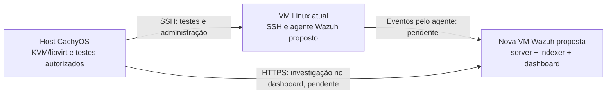

# Arquitetura da V1 Linux

Status: proposta documentada; Wazuh ainda não instalado ou validado. A alocação da nova VM depende da verificação dos recursos disponíveis no host.

## Problema empresarial simulado

Uma pequena empresa possui registros locais espalhados e precisa centralizar eventos de segurança para triagem e investigação. O laboratório começa com um servidor Linux e autenticações SSH; a V1 deve demonstrar como um analista SOC N1 relaciona registros, verifica contexto e decide encerrar ou escalar um alerta.

## Inventário observado

Dados obtidos de saídas de comandos fornecidas pelo responsável em 19/10/2026. Identificadores pessoais e endereços reais foram omitidos. Não houve acesso direto do assistente ao laboratório.

| Item da VM Linux atual | Resultado observado | Fonte |
| --- | --- | --- |
| Sistema | Ubuntu 24.04.5 LTS, x86-64 | `hostnamectl` |
| Virtualização | KVM, gerenciada por libvirt no host CachyOS | `hostnamectl` e `virsh list --all` |
| Processadores lógicos disponíveis | 2 | `nproc` |
| RAM | 1,9 GiB total; 1,5 GiB disponível no momento da consulta | `free -h` |
| Swap | 2,0 GiB, sem uso no momento da consulta | `free -h` |
| Disco virtual | 25 GB | `lsblk` |
| Partição `/boot` | 2 GB | `lsblk` |
| Partição LVM | 23 GB | `lsblk` |
| Volume lógico da raiz | 11,5 GB | `lsblk` |
| Sistema de arquivos da raiz | ext4; 12 GB arredondados, 5,2 GB usados e 5,6 GB disponíveis | `df -h /` |
| Grupo LVM | `ubuntu-vg`, tamanho inferior a 23 GB e 11,50 GB livres no grupo | `sudo vgs -o vg_name,vg_size,vg_free` |

Espaço livre no grupo LVM ainda não está disponível para arquivos na raiz. Ampliar a raiz consumindo esse espaço seria uma alteração de armazenamento; não foi executada. Mesmo essa ampliação ficaria limitada ao disco virtual de 25 GB.

O host foi identificado como CachyOS. Ryzen 5 5500 e 16 GB de RAM foram informados pelo responsável. Uma consulta posterior de `free -h` no host mostrou 15 GiB utilizáveis, 9 GiB usados e 6,5 GiB disponíveis, com swap de 15 GiB quase sem uso. O pool `default` do libvirt mostrou 740,47 GiB de capacidade e 446,65 GiB disponíveis. Esses valores variam e devem ser reconfirmados antes da implantação. A capacidade de executar ambas as VMs simultaneamente ainda não foi demonstrada. A VM Windows estava desligada na listagem fornecida e fica fora da V1.

## Referência oficial consultada

Consulta em 19/10/2026 ao código-fonte do Quickstart no repositório oficial do Wazuh:

- [Quickstart, fonte consultada em revisão fixa](https://github.com/wazuh/wazuh-documentation/blob/ef19184ea37743f9f50289cb2c68976dc18b3961/source/quickstart.rst).
- [Página pública do Quickstart](https://documentation.wazuh.com/current/quickstart.html), para consulta durante a instalação.

A consulta foi feita ao arquivo oficial no GitHub. A versão renderizada do site não foi verificada nesta etapa. A revisão fixa registra exatamente a fonte usada para este dimensionamento.

O Quickstart reúne Wazuh server, indexer e dashboard na mesma máquina e recomenda, para 1 a 25 agentes, **4 vCPU, 8 GiB de RAM e 50 GB de armazenamento**, considerando **90 dias de alertas consultáveis/indexados**. Esses números são recomendações para essa faixa e retenção, não medições do consumo deste laboratório. Ubuntu 24.04 x86-64 está entre os sistemas recomendados na fonte consultada.

## Proposta de implantação

Manter a VM Linux atual como servidor monitorado e instalar os componentes centrais do Wazuh em uma segunda VM Ubuntu 24.04 x86-64, na rede NAT do laboratório.

| Componente | Papel | Recursos propostos |
| --- | --- | --- |
| VM Linux atual | Servidor da empresa simulada; recebe testes e executa o agente Wazuh | Manter inicialmente 2 processadores disponíveis, aproximadamente 2 GiB de RAM e disco de 25 GB; acompanhar consumo após instalar o agente |
| Nova VM Wazuh | Centralizar, analisar, indexar e apresentar os eventos | 4 vCPU, 8 GiB de RAM e disco virtual de 80 GB; planejar a raiz com pelo menos 50 GB utilizáveis para os componentes e seus dados |
| Host CachyOS | Executar as VMs, acessar o SSH e o dashboard e originar testes autorizados | Reservar recursos para o sistema e aplicações; confirmar disponibilidade antes de criar a VM |

O disco de 80 GB é uma proposta local para dar margem ao sistema e aos dados. Não é um novo requisito oficial, nem assegura uma retenção específica. Com apenas um agente, o consumo deve ser medido após a implantação. Não manter a VM Windows ligada durante a V1 se isso comprometer os recursos do host.

O responsável decidiu tentar a nova VM de 8 GiB com a carga atual do host, após ser informado da disponibilidade de 6,5 GiB e da possibilidade de pressão de memória e lentidão. A nova VM ainda não foi criada; desempenho e uso de swap precisam ser acompanhados durante a tentativa. A disponibilidade de disco observada atende à proposta de 80 GB, mas não comprova desempenho ou capacidade de memória.

O diagrama representa o destino proposto, não serviços já implantados. O agente coleta eventos; o server analisa; o indexer armazena os dados para busca; o dashboard é a interface de consulta. Acesso externo às VMs não está proposto. IPs, portas e regras de comunicação serão registrados conforme a configuração efetivamente aplicada e validada.

## Validação e decisões pendentes

1. Atualizar a consulta de recursos do host e avaliar a execução simultânea das duas VMs; as consultas iniciais e a decisão de tentar estão registradas acima.
2. Definir a alocação final e criar a VM central, preservando a VM Linux atual.
3. Consultar novamente a documentação oficial antes de fornecer comandos de instalação; registrar versão escolhida, procedência dos pacotes e configuração aplicada, sem segredos.
4. Instalar os componentes centrais e o agente, validar a origem dos registros e o caminho efetivo de coleta do SSH.
5. Executar os quatro casos: falhas repetidas, falhas seguidas de sucesso, criação de usuário e alteração de privilégios. Confrontar cada resultado com regras existentes antes de justificar personalizações.
6. Incluir atividade legítima, decisões de triagem/escalonamento e limitações. Alerta indica uma condição detectada; suspeita exige verificação; incidente depende de evidências e contexto.

A [falha SSH já confirmada](evidencias/validacao-inicial-ssh.md) valida a leitura do registro original, mas ainda não demonstra centralização, detecção no Wazuh ou qualquer dos quatro casos completos.
